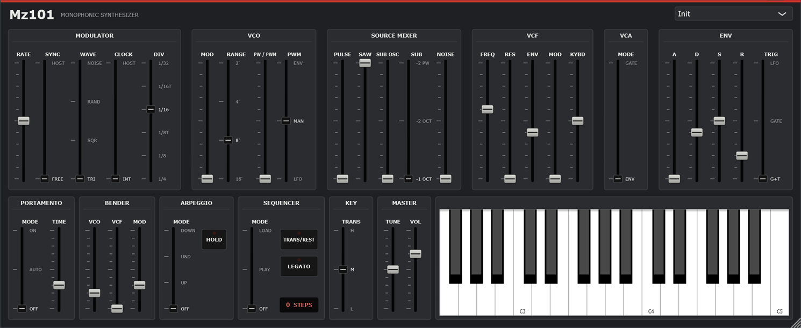

# Mz101

**An SH-101 for your DAW.** Mz101 is a VST3 instrument, and a standalone app, that emulates
the Roland SH-101 monophonic synthesizer of 1982. That's the rubbery bass, squelching
acid lines and bleeping arpeggios of a few decades of electronic music.

Mz101 is built from the original circuit, not from a feature list. Each block of the 101's
signal path is modelled for how the hardware behaves, using Roland's 1982 service manual as
the reference:

- **The CEM3340 oscillator.** Saw, pulse and sub oscillator all come from one core and play
  at once into the mixer. The sub is locked to the core, so it never beats against it.
- **The IR3109 filter.** A 24 dB/octave filter with its resonance circuit. It saturates when
  pushed, thins the bass as resonance rises, and whistles on its own at the top, in tune with
  the keyboard.
- **Snappy envelopes.** Analog curves throughout, with the fast-arriving attack that gives
  the 101 its punch.
- **The quirks left in.** Slow pitch drift, a power rail that dips as notes start, and the
  101's CPU, which reads the keyboard every few milliseconds and gives its sequencer a slightly
  loose, human feel.

Laid out like the original panel, with everything the hardware has:
- arpeggiator (up, up & down, down)
- 100-step sequencer with rests and ties
- portamento (off, auto, on)
- key transpose
- the bender's pitch and filter bend, and its vibrato push

On top of that, some things for modern use:
- **DAW sync.** Lock the sequencer and arpeggiator to your project's tempo with CLOCK and DIV.
  Lock the LFO to note lengths, 4 bars down to 1/32, with SYNC.
- **MIDI control.** Every control has a MIDI CC, using the General MIDI 2 numbers where one
  exists. Right-click any control to MIDI-learn your own.
- **Hover hints.** Hover over any control to see what it does and which CC moves it.
- **Ten factory patches,** from *Rubber Bass* and *Acid Line* to *Resonance Whistle*. Your
  own patches and sequences are saved with your project.

There is no velocity and the instrument is monophonic, because the 101 is.

Mz101 is an independent project. Roland and SH-101 are Roland's trademarks.

## Installing

Download `Mz101-<version>-win64-Setup.exe` from the
[releases page](https://github.com/simozzer/Mz101/releases) and run it. It installs the VST3,
the standalone app, or both, and asks whether to install for everyone or just you:

- **Everyone** (needs administrator rights) puts the VST3 in
  `C:\Program Files\Common Files\VST3`, which every DAW scans.
- **Just me** puts it in `%LOCALAPPDATA%\Programs\Common\VST3`. Some DAWs need that folder
  added to their plugin paths once; in Ableton Live it goes under
  *Preferences → Plug-Ins → VST3 Plug-In Custom Folder*.

Then rescan plugins in your DAW. The installer isn't code-signed, so Windows may warn about an
unknown publisher: choose *More info → Run anyway*. Uninstall from *Settings → Apps*.

To build it yourself instead, see [Building](#building).

The standalone app, `Mz101.exe`, plays without a DAW. Its *Options* button chooses the audio
and MIDI devices.

### macOS (beta)

Download `Mz101-<version>-macOS-beta.zip` from the
[releases page](https://github.com/simozzer/Mz101/releases) and unzip it. It holds the VST3,
an Audio Unit (for Logic and GarageBand) and the standalone app, for Apple Silicon and Intel
Macs on macOS 11 or later.

They aren't signed by Apple, which takes a paid developer account, so macOS won't open them
with a double-click. Install them from Terminal instead. Type `bash ` (with the space), drag
`install.sh` from the unzipped folder into the Terminal window, and press Return:

    bash ~/Downloads/Mz101-<version>-macOS-beta/install.sh

It copies everything into your own Library folders, with no password needed, and clears the
"downloaded from the internet" flag that would stop your DAW loading the plugin. Then rescan
plugins in your DAW. `READ ME FIRST.txt` in the zip explains how to install by hand instead.

It's a beta: built and checked on GitHub's Macs, including Apple's own Audio Unit validator,
but not yet tried on a real one. If something doesn't work, please
[open an issue](https://github.com/simozzer/Mz101/issues).

### Linux (beta)

Download `Mz101-<version>-linux-x86_64-beta.tar.gz` from the
[releases page](https://github.com/simozzer/Mz101/releases) and unpack it. It holds the VST3, an LV2 and the standalone app, for 64-bit x86 PCs on Ubuntu 22.04 or later, or another distribution as new.
Install it with one command in the unpacked folder:

    bash install.sh

It copies the plugins into `~/.vst3` and `~/.lv2`, where Linux hosts (Ardour, Bitwig,
Reaper, Carla, Qtractor, Zrythm) look for them, with no password needed. Then rescan plugins
in your DAW. `READ ME FIRST.txt` in the archive explains how to install by hand, and the
few libraries a minimal system might need.

It's a beta: built and checked on GitHub's Ubuntu machines, but not yet tried much in real
Linux hosts. If something doesn't work, please
[open an issue](https://github.com/simozzer/Mz101/issues).

## Building

Needs Visual Studio 2022+ with *Desktop development with C++*, and JUCE checked out beside
this repository (`..\JUCE`, or pass `-DJUCE_PATH=`).

    .\build.ps1                 engine check, then the VST3 and the standalone
    .\build.ps1 -NoPlugin       engine check only
    .\build.ps1 -Wav out        and render demo phrases into out\ to listen to
    .\build.ps1 -Release        and the release downloads into dist\: Setup.exe and two zips

`-Release` needs [Inno Setup 6](https://jrsoftware.org/isdl.php). The installer's script is
`installer\Mz101.iss`, and it takes its version from `CMakeLists.txt`.

## Releasing

GitHub builds the downloads for every release and attaches them, so each one has its
installer:

1. Bump the version in `CMakeLists.txt`.
2. Write the notes in `docs/releases/v<version>.md`, ending with the credit line
   (copy it from the last release's notes), then commit both.
3. Tag and push: `git tag -a v0.2.0 -m "Mz101 0.2.0"`, then `git push origin main v0.2.0`.
4. The *release* workflow builds and checks the plugin, then makes a **draft** release with
   the notes and the three Windows downloads. A few minutes later its Mac job adds
   `Mz101-<version>-macOS-beta.zip` to the same draft. Read it over on GitHub and publish it.

The Mac build is `.github/workflows/mac.yml`. It also runs on every push to `main`, as a
check, and keeps the zip on the run for two weeks.

The workflow stops if the tag and the version in `CMakeLists.txt` disagree. If you create
the release on GitHub with a new tag instead, the downloads are added to it a few minutes
later. To rebuild an existing release's downloads, run the workflow from the *Actions* tab
with that tag.

The VST3 is installed to `%LOCALAPPDATA%\Programs\Common\VST3`, the per-user folder, which
needs no administrator rights. Some hosts need that folder adding to their plugin paths once.

## Layout

    Source/SH101/        the instrument - plain C++, no JUCE
      Vco.h              CEM3340-style saw core; pulse by comparator; sub by flip-flops
      Vcf.h              IR3109 OTA cascade with the 101's resonance phase splitter
      Envelope.h         analog ADSR with overshooting attack
      Lfo.h              modulator, which is also the arpeggio/sequencer clock
      Sync.h             the note lengths the modulator can lock to
      Decimator.h        back down from the oversampled rate
      Engine.h/.cpp      keyboard, portamento, arpeggio, sequencer, rail, VCA
      Settings.h         the front panel, in panel units
    Source/              the JUCE plugin round it: parameters, presets, editor
    Tests/DspCheck.cpp   the engine's checks; gates the plugin build

## How it works

The reference is Roland's *SH-101 Service Notes*, first edition, Nov 1982: the specifications,
block diagram, CPU program description, adjustment procedures, schematic and parts list.
Where the model goes beyond what that states, it says so below.

**VCO (CEM3340, IC13).** One sawtooth core, with every waveform taken from it at once and
blended in the mixer, as on the hardware. Pulse comes from a comparator against the ramp, so
PWM (from the LFO, the envelope or the manual slider) is continuous. Its range is 50% down to
0% (spec), so at the top the pulse vanishes. The sub oscillator comes from a 4013 dual
flip-flop (IC17) clocked by the core (−1 oct square, −2 oct square, −2 oct 25% pulse), so it
is phase-locked to the core. Every edge is band-limited at its exact sub-sample position.
RANGE is a CV from the CPU's D/A converter (16′ = 1 V to 2′ = 4 V) into the VCO only.

**VCF.** Four OTA integrators, each saturating on the difference between its input and
output (`dy/dt = wc·tanh(in − y)`). Each stage is solved with zero-delay feedback, so cutoff and
resonance stay accurate to the top of the range. Resonance goes through the 101's phase
splitter: the inverted side feeds back through clipping diodes, and the non-inverted side is
added to the output. So resonance thins the bass, but less than a plain four-pole would. At
full resonance it self-oscillates as a near-sine that tracks the keyboard 1:1 at KYBD 10.

**Envelope.** A discrete transistor circuit (TR30–37), separate from the IR3109. RC
segments throughout. The attack charges toward 1.3× the peak and is cut off at the peak, so
it arrives fast with a sharp corner into the decay. Retriggers start from wherever the
capacitor is. Ranges follow the spec: A 1.5 ms–4 s, D/R 2 ms–10 s. The A/D/R sliders are
treated as the 1 MΩ audio-taper parts in the parts list, used as variable resistors, so most
of the time range is in the top half of their travel. That assignment is inferred from the
parts list, not stated in the manual.

**VCA (BA662A, IC15).** An OTA, driven by the envelope or the gate.

**Modulator.** Triangle, square, random and noise, 0.1–30 Hz. RANDOM is not a
sample-and-hold of the noise generator: the CPU generates random data each time it sees the
clock go high and writes it out through its D/A converter (CPU program, steps 6a and 7). The
modulator is the instrument's clock. The arpeggiator and sequencer step on it, and the
envelope's LFO trigger takes it directly through the trigger generator.

**LFO sync** is not on the original.
- **FREE:** the modulator runs at RATE in hertz, as on the hardware.
- **HOST:** it locks to the DAW's tempo and timeline, and RATE picks a note length. The
  lengths run from 4 bars down to 1/32, with dotted (.) and triplet (T) values; the slider's
  popup shows the current one. A 1-bar sweep always starts on the downbeat, and a key press
  can't restart it off the grid.
- **Transport stopped:** it keeps running at the last tempo, so the sound doesn't freeze.
- **Interaction with the clock:** with CLOCK on INT, the sequencer and arpeggiator step on
  the modulator, so a synced LFO puts them on the grid too.

**Clock.** CLOCK and DIV stand in for the hardware's EXT CLK IN jack.
- **INT:** the arpeggiator and sequencer step once per modulator cycle, as on the original.
- **HOST:** they step on the DAW's beat grid at the DIV setting (1/4, 1/8, 1/8T, 1/16, 1/16T
  or 1/32), with the gate open for the first half of each step. Nothing steps while the
  transport is stopped. The plugin re-reads the DAW's position every block, so it stays
  locked through loops and tempo changes.
- **The modulator in HOST:** it keeps its own RATE for modulation. RANDOM steps with the
  active clock, because the CPU makes a new value on each clock edge.
- **Starting an arpeggio:** an external clock can't be reset, so an arpeggio starts on the
  next grid step rather than the moment a key goes down.
- **Standalone app:** there is no DAW timeline, so HOST falls back to INT.

**The CPU.** An 80C49 runs a loop every 1.5–3.5 ms: read the keyboard, check the clock,
read the buttons, write the KCV, gate and LEDs (CPU program, steps 3–13). Keys and clock
edges are acted on only when the simulated CPU next comes round, so they land 0–3.5 ms late,
unevenly, as on the hardware. A key press resets the clock (Clock Reset, step 13) when TRIG
is on LFO or the arpeggiator is running, but not in PLAY.

**Analog behaviour.** Slow thermal pitch drift, faster sub-cent jitter, and a power rail that
dips on envelope triggers and on oscillator switching transients. The regulator corrects a
steady load, so the rail only moves when the load changes. The rail also carries a trace of
100 Hz ripple. Pitch and cutoff both follow the rail.

**Performance.** Last-note priority, no velocity (the 101 has none). Portamento is an RC
glide that slows as it arrives, 0–5 s on a 2 MΩ audio-taper pot (spec and bender board), with
OFF / AUTO (legato only) / ON. Bender lever: pitch wheel moves VCO and VCF, mod wheel brings
in LFO to the VCO. Transpose L/M/H shifts the keyboard CV by an octave, so filter tracking
follows it.

**KEY TRANSPOSE.** Press TRANS/REST, then a key: the distance of that key from middle C (the
lowest C on the 101's keyboard) is added to the RANGE data, within the D/A converter's
0–5 V. So it moves the VCO but not the filter's keyboard tracking (CPU program, step 4).

**Sequencer.** 100 steps.
- **Recording:** set MODE to LOAD (this clears the sequence) and play notes. TRANS/REST
  enters a rest, as KEY TRANSPOSE does in LOAD on the hardware. LEGATO ties the next note to
  the previous one, and so does overlapping two keys. A tied step does not restart the
  envelope, and it glides with portamento AUTO.
- **Playing:** set MODE to PLAY and hold a key. The key transposes the sequence relative to
  middle C. HOLD latches it.
- **Saving:** the sequence is saved with the host project.

## MIDI

Pitch bend is the bender lever's VCO/VCF bend; CC 1 is its MOD (vibrato) push. Every panel
control also has a fixed CC. A CC moves the control itself, so the panel follows and the host
can record it. 0–127 covers the whole travel, and a switch takes the nearest position. Hover
over any control for what it does and its CC.

Where General MIDI 2 defines a matching controller, that number is used. HOLD is the sustain
pedal.

| Section | Control | CC | | Section | Control | CC |
|---|---|---|---|---|---|---|
| Modulator | Rate | 76 | | ENV | Attack | 73 |
| | Waveform | 14 | | | Decay | 75 |
| VCO | Mod | 77 | | | Sustain | 79 |
| | Range | 15 | | | Release | 72 |
| | Pulse width | 16 | | | Trigger | 27 |
| | PWM source | 17 | | Portamento | Mode | 65 |
| Mixer | Pulse | 18 | | | Time | 5 |
| | Saw | 19 | | Bender | VCO | 28 |
| | Sub | 20 | | | VCF | 29 |
| | Sub waveform | 21 | | | Mod | 30 |
| | Noise | 22 | | Arpeggio | Mode | 102 |
| VCF | Freq | 74 | | Sequencer | Mode | 103 |
| | Res | 71 | | | Hold | 64 |
| | Env | 23 | | Key | Transpose | 104 |
| | Mod | 24 | | Master | Tune | 105 |
| | Kybd | 25 | | | Volume | 7 |
| VCA | Mode | 26 | | Clock | Source | 106 |
| | | | | | Division | 107 |
| | | | | Modulator | Sync | 108 |

The table lives in `Source/Params.cpp`. Each control's CC, hover hint and saved state are
defined there together.

**MIDI learn.** Right-click any control (or its label) to open its menu:
- **MIDI Learn:** the control is outlined in red until a CC arrives, and that CC is assigned
  to it. Right-click again to cancel.
- **Forget CC:** the control stops answering to MIDI.
- **Restore default:** puts back the CC from the table above.
- **Reset all CCs to defaults.**

Each CC drives one control at a time. If you learn a CC that another control was using, that
control loses it. CCs 0 and 32 (bank select), 1 (the mod lever) and 120 and up (channel mode)
can't be learned. Assignments are saved with the project, and the hover hint always shows a
control's current CC.

## Not yet calibrated against hardware

Two deliberate departures from the hardware:
- **Tuning:** Roland calibrated to A4 = 442 Hz. Mz101 defaults to 440 Hz; TUNE covers the
  difference.
- **Key range:** the D/A converter limits the keyboard CV to 0–5 V, about 5 octaves. MIDI
  notes outside that range are not clamped.

Ranges come from the spec. The curves within those ranges, and the internal
levels (filter drive, diode knee, envelope overshoot, modulation depths, rail amounts), are
reasoned from the circuit rather than measured from a real SH-101. The next step towards
"as close as possible" is to measure a real unit and fit these numbers. Each is a single
named constant.

## Licence

Created by Simon Moscrop.

Mz101 is free software under the GNU Affero General Public License v3; see
[LICENSE](LICENSE). It is built with [JUCE](https://juce.com), used under the same licence.
